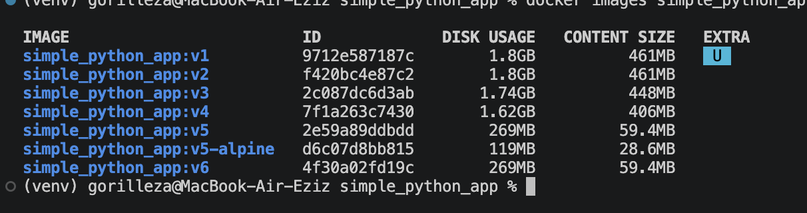
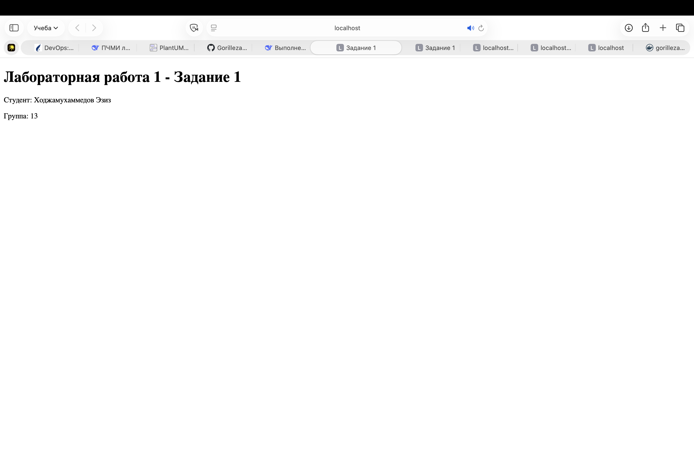
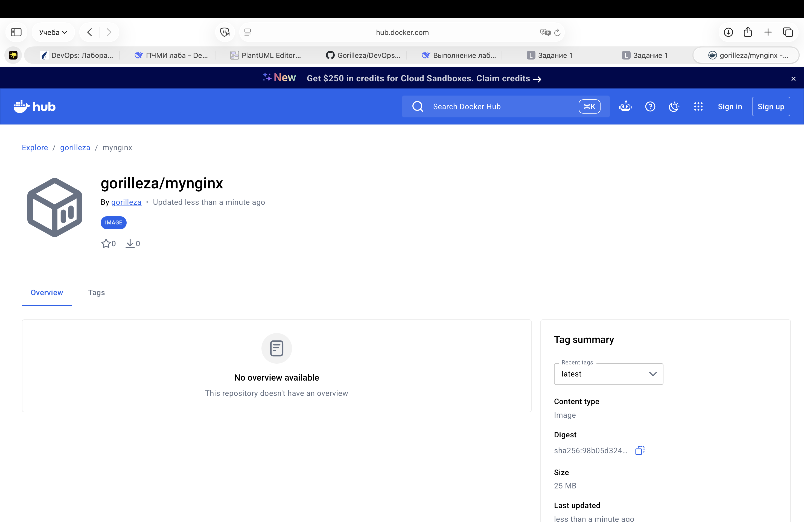

# Лабораторная работа №1. Управление многоконтейнерными системами

**Студент:** Ходжамухаммедов Эзиз  
**Группа:** 13  
**Вариант:** Группа 13 — выполнение заданий 1–4.

---

## Цель работы
Изучение современных технологий контейнеризации, создание многоконтейнерных инфраструктур с помощью Docker и Docker Compose.

---

## Задание 1. Основы управления контейнерами и образами контейнеров Docker

В ходе выполнения задания были изучены и применены базовые команды Docker.

**Вывод списка активных контейнеров (`docker ps`):**

**Запуск трех контейнеров Nginx:**
Были запущены контейнеры с именами `mynginxlast` (порт 8081), `mynginxalpine` (порт 8082) и `mynginx1-28` (порт 8083).
*(Вставь сюда скриншот браузера с тремя вкладками nginx)*

**Создание кастомной HTML-страницы:**
Был создан файл `task1/index.html`, который монтируется в контейнер `mynginxalpine` через volume.

**Работа с контейнером (exec и интерактивный режим):**

---

## Задание 2. Создание и публикация образа контейнера в репозиторий

Был создан Dockerfile на основе `nginx:alpine`, который копирует нашу HTML-страницу в контейнер. Образ успешно собран и опубликован на Docker Hub.

**Ссылка на образ:** [https://hub.docker.com/r/gorilleza/mynginx](https://hub.docker.com/r/gorilleza/mynginx)

---

## Задание 3. Настройка конфигурации многоконтейнерных систем в консоли и с помощью Dockerfile

### 1. Код приложения (app.py)
*(Вставь сюда полный код app.py из папки task3)*

### 2. Оптимизация Dockerfile
Были созданы и проверены 6 версий Dockerfile с разными техниками оптимизации (сортировка слоев, удаление кеша, multi-stage сборка, использование alpine и запуск от non-root пользователя).

**Результаты размеров образов:**
| Версия | Что меняли | Размер (DISK USAGE) |
|--------|------------|---------------------|
| v1 | Базовый образ | 1.8 GB |
| v2 | Сортировка слоев | 1.8 GB |
| v3 | Только app.py (mount) | 1.74 GB |
| v4 | Удаление кешей | 1.62 GB |
| v5 | Multi-stage (slim) | 269 MB |
| v5-alpine | Alpine Linux | 119 MB |
| v6 | Запуск от non-root | 269 MB |

### 3. Проверка запуска от имени обычного пользователя
Вывод команды `docker run --rm simple_python_app:v6 id`:

Вывод команды `docker run --rm simple_python_app:v5 id`:

---

## Задание 4. Применение Docker Compose

Была создана инфраструктура из трех сервисов: `web` (Nginx), `simple_python_app` (FastAPI) и `db` (PostgreSQL). Взаимодействие описано в файле `compose.yaml`.

### Код compose.yaml

### Код Dockerfile для приложения

### Код конфигурации Nginx (app.conf)

**Результат работы:**
Запуск выполнен командой `docker compose up -d`. Все сервисы успешно запустились. Nginx перенаправляет запросы на Python-приложение, которое успешно подключается к базе данных.
---

## Ответы на контрольные вопросы

**1. Что такое Docker и зачем он нужен? В чём ключевые преимущества для разработки и эксплуатации? Какие есть альтернативные системы контейнеризации и в каких сценариях они предпочтительнее?**
Docker — это платформа для разработки, доставки и запуска приложений в контейнерах. Контейнер — это изолированная среда, содержащая код и все зависимости. Преимущества: единообразие окружения (работает везде одинаково), высокая скорость развертывания, эффективное использование ресурсов (по сравнению с ВМ). Альтернативы: Podman (более безопасный, работает без демона, запускается от rootless-пользователя), containerd (низкоуровневый движок, используется под капотом Kubernetes).

**2. Что такое Docker-образ? Как его получить (из реестра, через сборку, из контейнера)? В чём разница между образом и контейнером?**
Образ — это неизменяемый шаблон (набор слоев), содержащий файловую систему и метаданные для запуска. Получить: скачать из реестра (`docker pull`), собрать по Dockerfile (`docker build`), создать из контейнера (`docker commit`). Контейнер — это запущенный экземпляр образа с добавленным сверху слоем для чтения/записи.

**3. Как запустить контейнер? Как пробросить порты, чтобы получить доступ к сервису снаружи? Как задать имя контейнера и ограничить ресурсы?**
Запуск: `docker run`. Проброс портов: флаг `-p 8080:80` (хост:контейнер). Имя: флаг `--name my-container`. Ограничение ресурсов: `--cpus="1.5"` и `--memory="512m"`.

**4. Как просмотреть логи контейнера? Как фильтровать логи по времени, по строкам, по уровню? Как настроить ротацию логов?**
Логи: `docker logs <container>`. Фильтрация: `--since 10m` (по времени), `--tail 100` (по строкам), `-f` (в реальном времени). Для фильтрации по уровню (ошибки) обычно используют `grep` в связке с логами. Ротация настраивается в `/etc/docker/daemon.json` (параметры `max-size`, `max-file`) или через драйверы логирования при запуске.

**5. Как сохранить данные внутри контейнера между перезапусками? В чём разница между volume, bind mount и tmpfs?**
Данные сохраняются с помощью volume (томов). `volume` — управляется Docker, хранится в его директории (лучше для БД). `bind mount` — монтирует конкретную папку с хоста (удобно для разработки). `tmpfs` — хранится в оперативной памяти (для временных/секретных данных, удаляется при остановке).

**6. Как подключить контейнеры к одной сети? Какие типы сетей бывают?**
`docker network create my-net` и `docker run --network my-net ...`. Типы: `bridge` (по умолчанию, изолированная сеть на хосте), `host` (контейнер использует сеть хоста напрямую), `overlay` (для связи между разными хостами в Swarm), `none` (без сети).

**7. Почему контейнеры могут обращаться друг к другу по имени? Как Docker разрешает имена внутри сети?**
Docker имеет встроенный DNS-сервер для пользовательских сетей. Когда контейнеры в одной сети, Docker автоматически резолвит их имена (или алиасы) в IP-адреса. Если контейнер перезапускается, его IP может измениться, но имя останется, и DNS будет возвращать новый IP.

**8. Что такое метки (docker tag)? Как правильно добавлять метки?**
Метка (тег) — это указатель на конкретную версию образа (например, `nginx:1.28`). `latest` — это просто тег по умолчанию, его не стоит использовать в production. Лучшая практика — семантическое версионирование (например, `v1.2.3`) или хеш коммита. Удалить тег: `docker rmi repo:tag`.

**9. Как удалить ненужные образы и контейнеры? Как автоматизировать очистку?**
Удаление контейнера: `docker rm`. Образа: `docker rmi`. Автоматизация: `docker system prune -a` (удаляет все неиспользуемые образы, контейнеры, сети и кеш сборки). Чтобы избежать удаления работающих контейнеров, `prune` не трогает запущенные процессы, но лучше проверять список перед удалением.

**10. Как выполнить команду внутри работающего контейнера? В чём разница между docker exec и docker attach?**
`docker exec -it <container> bash` — запускает новый процесс (например, терминал) внутри контейнера. `docker attach` — подключается к главному процессу (PID 1), при этом вывод дублируется. Если нажать Ctrl+C в attach, главный процесс может умереть (и контейнер остановится), поэтому чаще используют exec.

**11. Как узнать, какие файлы изменяет программа внутри контейнера?**
Команда `docker diff <container>` покажет изменения в файловой системе (A - добавлено, C - изменено, D - удалено) относительно исходного образа.

**12. Когда происходит завершение контейнера? Как корректно остановить контейнер?**
Контейнер завершается, когда завершается его главный процесс (PID 1). Корректная остановка: `docker stop` (отправляет SIGTERM, ждет 10 секунд и убивает SIGKILL). Время ожидания можно настроить флагом `--stop-timeout` или `stop_grace_period` в compose.

**13. Как работает кеширование слоев при сборке образа? Почему важен порядок инструкций?**
Docker кеширует каждый слой. Если файл или команда не изменились, слой берется из кеша. Порядок важен: редко меняемые инструкции (установка зависимостей) должны идти выше, а часто меняемый код (COPY app.py) — ниже. Это ускоряет пересборку. Также важно использовать `.dockerignore`, чтобы не копировать лишние файлы и не ломать кеш.

**14. К какому количеству слоёв стремиться в образе? Какие правила оптимизации?**
Стремиться к минимальному количеству слоев (объединять команды `RUN` через `&&`). Правила: сортировка слоев, очистка кеша (`rm -rf /var/lib/apt/lists/*`), использование `--no-install-recommends`, multi-stage сборка. Оценить размер: `docker image history <image>`.

**15. Опишите базовые команды Dockerfile.**
`FROM` (базовый образ), `RUN` (выполнить команду при сборке), `COPY` (скопировать файлы), `WORKDIR` (рабочая директория), `ENV` (переменные окружения), `EXPOSE` (порт), `CMD` (команда запуска по умолчанию), `ENTRYPOINT` (точка входа). Проверка на ошибки — линтер `hadolint`.

**16. Что такое контекст сборки?**
Контекст — это набор файлов, которые Docker отправляет демону для сборки (обычно текущая папка `.`). Влияет на `COPY` и `ADD`. Для оптимизации нужно использовать `.dockerignore`, чтобы исключить папки `venv`, `.git`, `__pycache__`.

**17. В чем разница между COPY и ADD?**
`COPY` просто копирует файлы. `ADD` умеет дополнительно распаковывать локальные архивы и скачивать файлы по URL. Best practice — использовать `COPY`, так как `ADD` может быть неявным и опасным.

**18. В чем разница между CMD и ENTRYPOINT?**
`ENTRYPOINT` задает исполняемую команду (например, `uvicorn`). `CMD` задает аргументы по умолчанию для ENTRYPOINT. В итоге выполняется: `ENTRYPOINT + CMD`.

**19. В чем разница между ARG и ENV?**
`ARG` — переменные только на время сборки (не сохраняются в контейнере). `ENV` — переменные окружения, доступные как при сборке, так и внутри работающего контейнера.

**20. Что такое Multi-stage builds?**
Это сборка в несколько этапов. Например, первый этап (builder) содержит компиляторы (gcc), собирает зависимости. Второй этап копирует только готовые артефакты (wheel) в чистый образ (slim). Это сильно уменьшает финальный размер.

**21. Из каких компонентов состоит Docker Engine?**
Демон (`dockerd`), REST API и клиент (`docker` CLI). Они общаются через сокет.

**22. Как посмотреть подробную информацию о контейнере?**
`docker inspect <container>` — выдает JSON с IP-адресом, томами, переменными окружения и т.д. Удобно использовать с `jq` (например, `docker inspect -f '{{.NetworkSettings.IPAddress}}' <container>`).

**23. Как посмотреть потребление ресурсов (CPU, RAM) контейнером в реальном времени?**
Команда `docker stats`.

**24. Основные возможности Docker Compose? В чём отличие между docker-compose и docker compose?**
Возможности: сервисы, тома, сети, профили, зависимости. `docker-compose` (с дефисом) — старый Python-скрипт. `docker compose` (через пробел) — новый плагин на Go, встроенный в CLI, быстрее, поддерживает новые фичи (например, `profiles`).

**25. Как в Docker Compose настроить порядок запуска сервисов с учетом их готовности?**
Для этого используется инструкция `depends_on` с условием `condition: service_healthy`. Это заставляет Docker Compose ждать, пока healthcheck базы данных не покажет, что она готова принимать подключения.

**26. Что такое Healthcheck в Docker и Docker Compose?**
Это команда, которая периодически проверяет, «жив» ли контейнер (например, `pg_isready` для Postgres). Если проверка не проходит, контейнер помечается как `unhealthy`.

**27. Как переопределить или дополнить базовый compose.yaml файл для разных окружений?**
Создать файл `compose.override.yaml`. Docker Compose автоматически читает его и мержит с основным при запуске. Либо явно указывать файлы: `docker compose -f compose.yaml -f compose.prod.yaml up`.

**28. Почему запускать процессы от имени root внутри контейнера — плохая практика? Как запустить от непривилегированного пользователя?**
Если злоумышленник выйдет из контейнера, он получит root на хосте. Для безопасности в Dockerfile создают пользователя (`RUN addgroup` / `adduser`) и переключаются на него с помощью инструкции `USER app`.

**29. Как сделать файловую систему контейнера доступной только для чтения?**
Использовать флаг `--read-only` при запуске или указать `read_only: true` в `compose.yaml`. Для временных файлов монтируют `tmpfs` (флаг `--tmpfs /tmp`), чтобы приложение могло писать в память, а не на диск.

**30. Как безопасно передавать секреты?**
В Docker Compose — через блок `secrets` (они монтируются как файлы в `/run/secrets/`). Также используют переменные окружения через `env_file`, но они видны в `docker inspect`. Лучший способ — Docker Swarm Secrets или внешние хранилища (Vault).

**31. Какие ограничения имеет Docker Compose при работе в Production? Почему используют оркестраторы?**
Compose работает только на одном хосте. Нет автоматического масштабирования, самовосстановления при падении ноды, балансировки нагрузки между серверами. Поэтому используют Kubernetes или Docker Swarm.

**32. Что такое Docker Swarm? Чем он отличается от Kubernetes?**
Swarm — встроенный оркестратор в Docker (проще в настройке, но менее гибкий). Kubernetes — мощный стандарт индустрии, сложнее, но имеет больше возможностей (автоскейлинг, управление состоянием, огромная экосистема).

---

## Выводы
В ходе лабораторной работы были изучены основы контейнеризации, освоены команды управления контейнерами и образами. Были созданы Dockerfile с применением различных техник оптимизации, что позволило уменьшить размер итогового образа с 1.8 ГБ до 119 МБ. Также была разработана и успешно запущена многоконтейнерная система с использованием Docker Compose, объединяющая веб-сервер, базу данных и Python-приложение.
